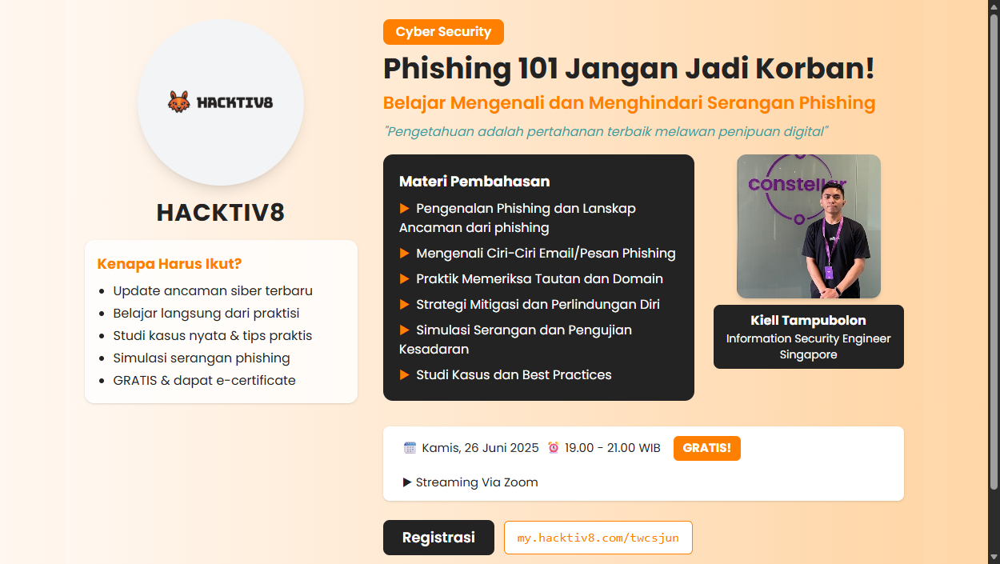

# Phishing 101: Jangan Jadi Korban!

An interactive web slide deck that teaches non-technical people how to recognise and avoid phishing, written in Bahasa Indonesia.

> Presentasi web interaktif tentang cara mengenali dan menghindari serangan phishing, dalam Bahasa Indonesia.

**Live demo:** https://phising101-kiel.vercel.app



## Who it is for

Indonesian-speaking audiences with no security background. It was built as the deck for a free Hacktiv8 webinar given by Kiell Tampubolon (26 June 2025, via Zoom), and works as a self-paced walkthrough for anyone who opens the link.

## Features

- **Landing page** with the session outline, speaker card and a "Mulai Slide" button to start the deck.
- **13 slides**, each a React component in `src/slides/`:
  1. What phishing is and how it works
  2. Speaker profile
  3. Why phishing is dangerous: financial loss, identity theft, reputation damage
  4. Types of phishing: spear phishing, whaling, clone phishing, BEC, vishing, smishing
  5. Red flags in a phishing email: odd sender address, urgent language, suspicious links, unexpected attachments, look-alike branding
  6. Demo: a fake bank email annotated with each red flag, next to what the real bank email would look like
  7. Phishing simulation example with GoPhish (shown for education only, nothing is sent)
  8. Prevention tips: verification, technical and behavioural controls, do and don't rules
  9. Protection strategy: MFA, password managers, updates, backups, VPN, anti-malware, email security habits
  10. Real cases from Singapore: a BEC invoice fraud and fake LinkedIn recruiters
  11. Free tools: VirusTotal, Have I Been Pwned, Bitwarden, an email header analyzer
  12. Q&A
  13. Closing
- **Navigation:** home, previous and next buttons with a slide counter, plus a fullscreen toggle on the first slide.
- **Animated slides** using Framer Motion.

## Run locally

Requires Node.js 18 or later.

```bash
git clone https://github.com/glatinone/phising101-kiel.git
cd phising101-kiel
npm install
npm start          # dev server on http://localhost:3000
npm run build      # production build in ./build
```

## Tech stack

- React 18 (Create React App / react-scripts 5)
- Tailwind CSS 3 with PostCSS and Autoprefixer
- Framer Motion for animation, Lucide and React Icons for icons
- Deployed on Vercel

## License

MIT. See [LICENSE](LICENSE).
